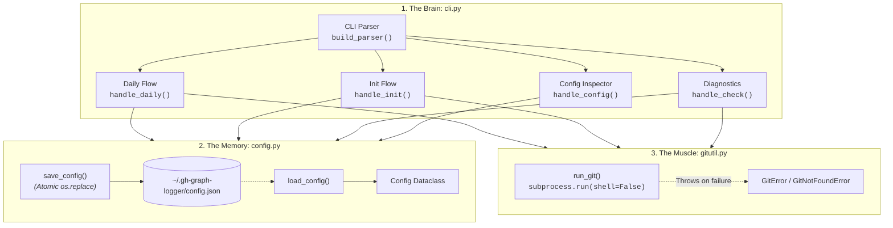
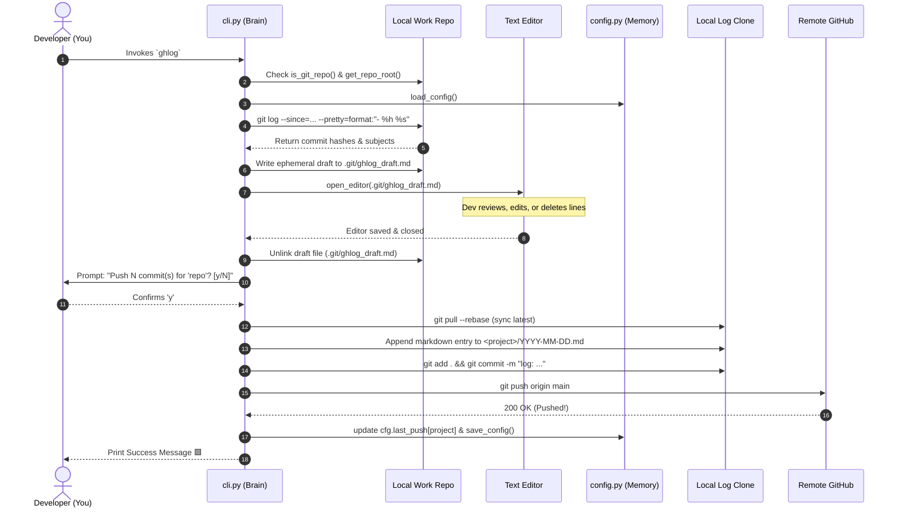

# 🎓 Building a Production Git CLI: The `gh-graph-logger` Masterclass

> **Course Level:** Intermediate Python & Systems Engineering  
> **Prerequisites:** Basic Python syntax (`def`, `import`, `with`) and basic Git familiarity (`git add`, `git commit`).  
> **Target Audience:** Aspiring backend engineers, CLI tool authors, and developers curious about how Git internals and GitHub's contribution graph really work.  
> **Estimated Completion Time:** 45 minutes  

---

## Module 1: The 60-Second Elevator Pitch 🎯

### What Problem Does `gh-graph-logger` Solve?
Picture this: You just spent 8 straight hours crushing code at your software engineering job. You pushed 14 commits, resolved two gnarly edge cases, and refactored a core API. 

Then you open your personal GitHub profile... and it looks like a barren wasteland. **Zero contributions.** A field of grey squares mocking your hard work.

```
Mon  ░  ░  ░  ░  ░  ░  ░  ░  ░  ░   <- 8 hours of intense client work...
Wed  ░  ░  ░  ░  ░  ░  ░  ░  ░  ░   <- ...and GitHub thinks you took a nap!
Fri  ░  ░  ░  ░  ░  ░  ░  ░  ░  ░
```

Why? Because your day job lives on an internal GitLab instance, a Bitbucket server, an enterprise GitHub on-premise box, or a client repo under a strict non-disclosure agreement (NDA). You cannot simply push proprietary enterprise code to your personal GitHub.

Enter **`gh-graph-logger`** (CLI command: `ghlog`).

`ghlog` is a zero-dependency Python CLI tool that acts as your personal **Git Diplomatic Courier**:
1. At the end of your day, you run `ghlog` inside your work repo.
2. It gathers all commits you authored today.
3. It pops open your favourite text editor with an ephemeral draft, allowing you to scrub or redact confidential ticket names or internal details.
4. Once you approve, it commits a sanitized Markdown summary into your personal GitHub log repository and pushes it.
5. GitHub's contribution engine spots the commits with your verified email and turns your contribution squares vibrant green! 🟩

```
Mon  ░  ░  🟩  🟩  ░  ░  ░  ░  ░  ░  <- Green squares unlocked!
Wed  ░  🟩  🟩  🟩  🟩  ░  ░  ░  ░  ░  <- Zero enterprise code leaked.
Fri  ░  ░  🟩  🟩  🟩  ░  ░  ░  ░  ░  <- 100% NDA-compliant.
```

---

### Terminal Preview: What Running `ghlog` Looks Like

Here is what happens on your terminal when you wrap up your day:

```text
$ cd ~/work/payment-gateway
$ ghlog

[1/4] 🔍 Scanning commits authored by 'developer@company.com' since midnight...
      Found 3 commits. Opening draft in editor...

[2/4] 📝 [VS Code opens .git/ghlog_draft.md]
      -> You redact: "fix internal API credentials" to "fix API token parsing"
      -> You save and close the editor tab.

[3/4] ❓ Push 3 commit(s) for 'payment-gateway' to log repo? [y/N]: y

[4/4] 🚀 Syncing with remote...
      Writing payment-gateway/2026-10-14.md...
      [OK] git add .
      [OK] git commit -m "log: payment-gateway 2026-10-14 17:30:00"
      [OK] git push origin main

✅ Successfully logged 3 commit(s) for 'payment-gateway' to git@github.com:yourname/daily-log.git!
```

---

### The Python Toolkit Decoded 🧰

Most beginner tutorials reach for 15 heavy third-party packages from PyPI before writing a single line of logic. `gh-graph-logger` takes the opposite approach: **Zero runtime dependencies.** 

It runs on pure Python 3.10+ standard library. Here is the toolkit:

| Module | What It Does in `gh-graph-logger` | One-Sentence Real-World Analogy |
| :--- | :--- | :--- |
| [`subprocess`](file:///c:/Users/admin/Desktop/Projects/Github%20Logger/gh-graph-logger/src/gh_graph_logger/gitutil.py#L6) | Safely runs `git` binary commands without shell injection. | The telephone line between Python and your operating system's command prompt. |
| [`argparse`](file:///c:/Users/admin/Desktop/Projects/Github%20Logger/gh-graph-logger/src/gh_graph_logger/cli.py#L5) | Parses terminal flags (`--since`, `--project`, `--yes`, subcommands). | The bouncer at the club door checking IDs and routing guests to the right room. |
| [`pathlib.Path`](file:///c:/Users/admin/Desktop/Projects/Github%20Logger/gh-graph-logger/src/gh_graph_logger/config.py#L9) | Handles file paths across Windows, macOS, and Linux cleanly. | A universal GPS that speaks fluent Windows backslashes (`\`) and Unix slashes (`/`). |
| [`json`](file:///c:/Users/admin/Desktop/Projects/Github%20Logger/gh-graph-logger/src/gh_graph_logger/config.py#L5) | Serializes and parses the `config.json` state file. | The filing cabinet that stores your settings in human-readable plain text. |
| [`tempfile`](file:///c:/Users/admin/Desktop/Projects/Github%20Logger/gh-graph-logger/src/gh_graph_logger/config.py#L7) | Creates safe temporary files for atomic configuration writes. | A scratchpad where you draft your letter before sealing the real envelope. |
| [`dataclasses`](file:///c:/Users/admin/Desktop/Projects/Github%20Logger/gh-graph-logger/src/gh_graph_logger/config.py#L8) | Defines typed `Config` data structures with defaults. | A blueprint that turns a messy Python dictionary into a structured, validated object. |
| [`shlex`](file:///c:/Users/admin/Desktop/Projects/Github%20Logger/gh-graph-logger/src/gh_graph_logger/cli.py#L8) | Splits complex editor commands (like `"C:\Program Files\..." --wait`). | A precision scissor that cuts command strings without slicing quoted spaces. |
| [`datetime`](file:///c:/Users/admin/Desktop/Projects/Github%20Logger/gh-graph-logger/src/gh_graph_logger/cli.py#L12) | Formats timestamps for Markdown headers and ISO-8601 state trackers. | The digital wall clock stamping exact dates on your daily logs. |
| [`re`](file:///c:/Users/admin/Desktop/Projects/Github%20Logger/gh-graph-logger/src/gh_graph_logger/cli.py#L7) | Cleans repository and project names into URL/file-safe slugs. | A metal detector that filters out illegal characters like spaces, `@`, and punctuation. |

---

## Module 2: The 10,000-Foot Architecture Map 🗺️

### The "Trinity" Architecture
The codebase follows a clean, decoupled design pattern: **The UI (Brain)**, **The State (Memory)**, and **The OS Interface (Muscle)**.



### The Execution Pipeline

Here is the exact lifecycle sequence when you run `ghlog`:



---

### The Annotated File Tree 🌲

Here is the entire repository structure. Look at how lean and focused it is:

```text
gh-graph-logger/
├── pyproject.toml              # 📦 Package blueprint: defines CLI aliases 'ghlog' and 'gh-graph-logger'
├── README.md                   # 📖 User-facing documentation and quickstart instructions
├── uv.lock                     # 🔒 Exact dependency lockfile for reproducible dev builds
│
├── src/
│   └── gh_graph_logger/        # 🐍 Core Python Package
│       ├── __init__.py         # 🏷️ Package metadata: declares __version__ = "0.1.0"
│       ├── __main__.py         # 🚀 Executable entry point: enables `python -m gh_graph_logger`
│       ├── gitutil.py          # 💪 THE MUSCLE: safe subprocess execution, timeout guards, UTF-8 safety
│       ├── config.py           # 🧠 THE MEMORY: dataclass model and atomic save_config() routines
│       └── cli.py              # 🎛️ THE BRAIN: argument parsing, editor spawning, and daily workflow
│
└── tests/                      # 🧪 57 Automated Unit & Integration Tests
    ├── conftest.py             # 🛡️ Hermetic test fixtures: isolates Git configs, mocks remotes
    ├── test_gitutil.py         # ⚙️ Tests subprocess edge cases, missing Git binaries, encoding crashes
    ├── test_config.py          # 💾 Tests JSON corruption recovery, atomic writes, GHLOG_HOME overrides
    └── test_cli.py             # 🚦 Full end-to-end integration tests: mocks editors, prompts, and git push
```

> [!TIP]
> **Where should a student look first?**  
> 1. Start with [`src/gh_graph_logger/gitutil.py`](file:///c:/Users/admin/Desktop/Projects/Github%20Logger/gh-graph-logger/src/gh_graph_logger/gitutil.py): It's only 114 lines and teaches you how to talk to operating system processes safely.  
> 2. Then read [`src/gh_graph_logger/config.py`](file:///c:/Users/admin/Desktop/Projects/Github%20Logger/gh-graph-logger/src/gh_graph_logger/config.py): It demonstrates robust state persistence and atomic file swapping.  
> 3. Finish with [`src/gh_graph_logger/cli.py`](file:///c:/Users/admin/Desktop/Projects/Github%20Logger/gh-graph-logger/src/gh_graph_logger/cli.py): See how the Brain orchestrates the other two modules into a smooth user experience.

---

## Module 3: Follow the Command (The Core Walkthrough) 🚀

Let's trace a real terminal command from the exact microsecond the user hits `Enter` to the final commit:

```bash
ghlog --since "yesterday"
```

---

### Stage 1: Catching the Flags (Terminal to Python Routing)

When you type `ghlog`, your operating system terminal looks at the entry points defined in [`pyproject.toml:24-27`](file:///c:/Users/admin/Desktop/Projects/Github%20Logger/gh-graph-logger/pyproject.toml#L24-L27):

```toml
[project.scripts]
gh-graph-logger = "gh_graph_logger.cli:main"
ghlog = "gh_graph_logger.cli:main"
```

The shell calls Python, which jumps into [`src/gh_graph_logger/cli.py:612`](file:///c:/Users/admin/Desktop/Projects/Github%20Logger/gh-graph-logger/src/gh_graph_logger/cli.py#L612):

```python
def main(argv: Sequence[str] | None = None) -> int:
    """Entry point for the CLI. Returns exit code integer."""
    try:
        parser = build_parser()
        args = parser.parse_args(argv)

        if args.subcommand is None or args.subcommand == "collect":
            return handle_daily(args)
        elif args.subcommand == "init":
            return handle_init(args)
        # ...
```

Notice the argument parsing in [`build_parser()` at line 555](file:///c:/Users/admin/Desktop/Projects/Github%20Logger/gh-graph-logger/src/gh_graph_logger/cli.py#L555-L582):

```python
parser = argparse.ArgumentParser(prog="ghlog", description="...")
parser.add_argument("--since", type=str, help="Collect commits since date/time")
parser.add_argument("--author", type=str, help="Author email(s) to filter by")
parser.add_argument("--project", type=str, help="Project name override")
parser.add_argument("--yes", "-y", action="store_true", help="Skip confirmation prompt")
```

> [!NOTE]
> **💡 Python Pro-Tip: The Subcommand Destination Trick**  
> In [`cli.py:579`](file:///c:/Users/admin/Desktop/Projects/Github%20Logger/gh-graph-logger/src/gh_graph_logger/cli.py#L579), notice `parser.add_subparsers(dest="subcommand")`.  
> By giving `dest="subcommand"`, if the user runs `ghlog` with no subcommand (e.g. just `ghlog --since yesterday`), `args.subcommand` evaluates to `None`!  
> Line 618 checks `if args.subcommand is None or args.subcommand == "collect":` and smoothly falls through to `handle_daily(args)`. This enables `ghlog` to act as both a root command and a suite of subcommands (`ghlog init`, `ghlog check`, `ghlog config`) without hacky manual parsing!

---

### Stage 2: The Brain / Date & Commit Math

Execution enters [`handle_daily(args)` at line 409](file:///c:/Users/admin/Desktop/Projects/Github%20Logger/gh-graph-logger/src/gh_graph_logger/cli.py#L409). 

#### 1. Environmental Guards
First, `ghlog` verifies that the environment is healthy before touching anything:
- Is the current working directory inside a Git repository? ([`cli.py:411`](file:///c:/Users/admin/Desktop/Projects/Github%20Logger/gh-graph-logger/src/gh_graph_logger/cli.py#L411))
- Does `config.json` exist? ([`cli.py:417`](file:///c:/Users/admin/Desktop/Projects/Github%20Logger/gh-graph-logger/src/gh_graph_logger/cli.py#L417))
- Does the local log repo clone exist on disk? ([`cli.py:422`](file:///c:/Users/admin/Desktop/Projects/Github%20Logger/gh-graph-logger/src/gh_graph_logger/cli.py#L422))

If any check fails, it exits early with `GUARD_FAILED` (`exit code 3`) or `ERROR` (`exit code 1`).

#### 2. Resolving Project, Author, and Time Horizon
Look at lines 429–438:
```python
project = slugify(getattr(args, "project", None) or repo_root.name)
author = getattr(args, "author", None)
if not author:
    try:
        author = run_git(["config", "user.email"], cwd=repo_root).strip()
    except Exception:
        author = cfg.github_email

since = getattr(args, "since", None) or cfg.last_push.get(project) or "midnight"
```

Look at that `since` fallback hierarchy!
1. Did the user pass `--since "yesterday"`? Use that.
2. If not, has this project been pushed before? Check `cfg.last_push.get(project)`.
3. If this is the first push of the day, default to `"midnight"`.

#### 3. Extracting Git Log Entries
`ghlog` constructs the exact Git arguments in lines 439–450:
```python
git_cmd = [
    "log",
    "--reverse",
    "--no-merges",
    f"--since={since}",
    "--pretty=format:- %h %s",
]
if author:
    git_cmd.append(f"--author={author}")

raw_log = run_git(git_cmd, cwd=repo_root).strip()
```

Notice `--pretty=format:- %h %s`. This formats each commit as:
`- a1b2c3d Add feature logic`
`- e4f5g6h Fix edge case in authentication`

#### 4. The Ephemeral Draft & Editor Launch
Here is the core security feature: `ghlog` does **not** blindly send your commits to GitHub. It creates a draft file and hands control to you:

```python
# cli.py lines 470-485
git_dir_str = run_git(["rev-parse", "--git-dir"], cwd=repo_root).strip()
git_dir = Path(git_dir_str)
draft_dir = git_dir if git_dir.is_absolute() else (repo_root / git_dir).resolve()
draft_file = draft_dir / "ghlog_draft.md"

try:
    draft_file.write_text(draft_text, encoding="utf-8")
    open_editor(draft_file)
    edited_text = draft_file.read_text(encoding="utf-8")
finally:
    if draft_file.exists():
        draft_file.unlink(missing_ok=True)
```

> [!NOTE]
> **💡 Python Pro-Tip: The `try...finally` Cleanup Guarantee**  
> What happens if your editor crashes or you press `Ctrl+C` while the editor is open?  
> Because the draft file is unlinked inside a `finally:` block, Python guarantees `draft_file.unlink()` will execute no matter how the block exits. No temporary junk files cluttering your `.git` folder!

---

### Stage 3: Pulling the Triggers (Filesystem Mutation & Git Push)

Once you close the editor:
1. Lines 486–494 parse the draft, filtering out comment lines starting with `#`.
2. Lines 497–502 ask for confirmation:
   ```python
   prompt_msg = f"Push {count} commit(s) for '{project}' to log repo? [y/N]: "
   confirm = input(prompt_msg).strip().lower()
   if confirm not in ("y", "yes"):
       safe_print("Aborted. Draft discarded.")
       return ABORTED
   ```
3. Line 505 syncs your log repository:
   ```python
   run_git(["pull", "--rebase"], cwd=clone_path, check=False)
   ```
4. Lines 508–518 write the entry to the Markdown file `<clone_path>/<project>/YYYY-MM-DD.md`:
   ```python
   date_file = now.strftime("%Y-%m-%d")
   project_dir = clone_path / project
   project_dir.mkdir(parents=True, exist_ok=True)
   target_file = project_dir / f"{date_file}.md"
   entry_body = f"## {now_str}\n\n" + "\n".join(kept_commits) + "\n"

   if target_file.exists():
       existing = target_file.read_text(encoding="utf-8")
       target_file.write_text(existing.rstrip() + "\n\n" + entry_body, encoding="utf-8")
   else:
       target_file.write_text(f"# {project}\n\n" + entry_body, encoding="utf-8")
   ```
5. Lines 522–547 stage, commit, and push:
   ```python
   run_git(["add", "."], cwd=clone_path)
   commit_msg = f"log: {project} {now.strftime('%Y-%m-%d %H:%M:%S')}"
   run_git(["commit", "-m", commit_msg], cwd=clone_path)
   run_git(["push"], cwd=clone_path, check=True)
   ```
6. Lines 549–550 update the state timestamp in `config.json`:
   ```python
   cfg.last_push[project] = now.isoformat()
   save_config(cfg)
   ```

---

## Module 4: Under the Hood — Git & CLI Gotchas 🧠

### How GitHub's Graph Actually Works

A lot of junior engineers believe GitHub runs an agent on your machine or counts lines of code. **It doesn't.**

GitHub's contribution graph is powered by a parser that inspects **Git Commit Objects** on the default branch of repositories pushed to GitHub.

```
       Git Commit Object
┌──────────────────────────────────────────────┐
│ Tree:       d8329f... (snapshot of files)    │
│ Parent:     7b11c0...                        │
│ Author:     Jane Dev <jane@example.com>      │ <- MUST MATCH VERIFIED GITHUB EMAIL!
│ AuthorDate: 2026-10-14 17:30:00 +0300        │ <- DETERMINES THE SQUARE DAY!
│ Committer:  Jane Dev <jane@example.com>      │
│ CommitDate: 2026-10-14 17:30:00 +0300        │
│                                              │
│ log: my-project 2026-10-14 17:30:00          │
└──────────────────────────────────────────────┘
```

For a commit to light up a green square on your profile, GitHub requires 3 specific conditions:
1. **The Email Matches:** The commit's author or committer email must match a verified email address added to your GitHub account (`Settings -> Emails`).
2. **The Destination Matches:** The commit must be in the default branch (usually `main`) or `gh-pages` of a repository you own or contributed to.
3. **The Push Event:** The commit must be pushed to GitHub's remote servers.

`gh-graph-logger` guarantees all three: in `_configure_clone_identity()` ([`cli.py:160`](file:///c:/Users/admin/Desktop/Projects/Github%20Logger/gh-graph-logger/src/gh_graph_logger/cli.py#L160)), it sets `user.email` inside your log clone to match your verified GitHub email!

---

### Why We Built It This Way: 3 Smart Architectural Decisions

#### 1. Atomic Config Writes (No Corrupt State)
Standard file writing with `open("config.json", "w")` truncates the file to 0 bytes before writing new data. If your battery dies or the process is killed mid-write, your config file is ruined.

In [`src/gh_graph_logger/config.py:73-85`](file:///c:/Users/admin/Desktop/Projects/Github%20Logger/gh-graph-logger/src/gh_graph_logger/config.py#L73-L85), `save_config()` writes to a temporary file first, then calls `os.replace`:

```python
temp_file = tempfile.NamedTemporaryFile("w", dir=target.parent, delete=False, encoding="utf-8")
temp_path = Path(temp_file.name)
try:
    json.dump(asdict(config), temp_file, indent=2)
    temp_file.flush()
    temp_file.close()
    os.replace(temp_path, target)  # <- ATOMIC SWAP!
except Exception:
    temp_path.unlink(missing_ok=True)
    raise
```
At the OS filesystem level, `os.replace()` is **atomic**. The file is either 100% the old version or 100% the new version. It is physically impossible to have a corrupt, half-written config file!

#### 2. The Push Failure Safety Net (Zero Data Loss)
What happens if you are in a coffee shop and your Wi-Fi drops *after* the local log commit is made, but *before* `git push` finishes?

In [`cli.py:539-550`](file:///c:/Users/admin/Desktop/Projects/Github%20Logger/gh-graph-logger/src/gh_graph_logger/cli.py#L539-L550):
```python
try:
    run_git(["push"], cwd=clone_path, check=True)
except GitError as exc:
    safe_print("Warning: Commit created locally, but push failed. Preserved locally...", file=sys.stderr)
    return ERROR

cfg.last_push[project] = now.isoformat()
save_config(cfg)
```
Notice that `cfg.last_push[project]` is updated **only after** `git push` succeeds. If pushing fails, your local commit remains safely saved in the clone, and `last_push` is not advanced. The next time you run `ghlog`, it will retry and push everything smoothly.

#### 3. Git Worktrees & Monorepo Support
Beginner scripts often hardcode `.git/ghlog_draft.md`. But in **Git worktrees** or **submodules**, `.git` is not a directory—it is a text file pointing to another path!

[`cli.py:471`](file:///c:/Users/admin/Desktop/Projects/Github%20Logger/gh-graph-logger/src/gh_graph_logger/cli.py#L471) asks Git directly for the true directory:
```python
git_dir_str = run_git(["rev-parse", "--git-dir"], cwd=repo_root).strip()
```
This guarantees `ghlog` works seamlessly inside advanced enterprise monorepos and multi-worktree setups.

---

### Common Footguns ⚠️

#### Footgun 1: Shell Injection & Argument Injection in `subprocess`
- **The Trap:** Using `shell=True` or formatting commands as raw strings like `f"git clone {user_input}"`. A malicious or malformed input like `https://github.com/foo/bar; rm -rf /` or `--upload-pack=touch /tmp/pwned` will execute arbitrary commands!
- **How We Prevent It:** 
  1. We use `shell=False` everywhere in [`gitutil.py:79`](file:///c:/Users/admin/Desktop/Projects/Github%20Logger/gh-graph-logger/src/gh_graph_logger/gitutil.py#L79). Arguments are passed as an isolated `list[str]`.
  2. In [`cli.py:178`](file:///c:/Users/admin/Desktop/Projects/Github%20Logger/gh-graph-logger/src/gh_graph_logger/cli.py#L178), we reject URLs starting with `-` or dangerous protocols (`ext::`, `fd::`).
  3. When passing user parameters to Git, we use `--` delimiters (e.g. `["clone", "--", url, str(target_dir)]` in [`cli.py:288`](file:///c:/Users/admin/Desktop/Projects/Github%20Logger/gh-graph-logger/src/gh_graph_logger/cli.py#L288)). In Git syntax, anything after `--` is strictly treated as a positional argument (path or URL), never a flag!

#### Footgun 2: Windows Quoted Paths with Spaces
- **The Trap:** On Windows, editors live in paths like `C:\Program Files\Microsoft VS Code\Code.exe --wait`. If you naively use `.split(" ")`, the executable becomes `'C:\Program'` and Windows throws `FileNotFoundError`!
- **How We Prevent It:**
  In [`cli.py:145-146`](file:///c:/Users/admin/Desktop/Projects/Github%20Logger/gh-graph-logger/src/gh_graph_logger/cli.py#L145-L146), we use `shlex.split(editor, posix=(os.name != "nt"))` and strip lingering outer quotes so Windows `CreateProcess` launches cleanly.

#### Footgun 3: Character Encoding Crashes on Terminal Output
- **The Trap:** Printing emojis like `✅` or `❌` directly crashes with `UnicodeEncodeError` on legacy Windows command prompts configured for code page 1252 or ASCII.
- **How We Prevent It:**
  [`safe_print()`](file:///c:/Users/admin/Desktop/Projects/Github%20Logger/gh-graph-logger/src/gh_graph_logger/cli.py#L54) and [`format_status()`](file:///c:/Users/admin/Desktop/Projects/Github%20Logger/gh-graph-logger/src/gh_graph_logger/cli.py#L65) inspect the output stream's encoding and fall back to `[OK]` and `[FAIL]` if unicode characters cannot be encoded.

---

## Module 5: Hands-On Quests (Learn by Doing) 🛠️

Now it is your turn to write code! Open the repository and complete these three progressive quests.

---

### Quest 1: The Tinkerer (Beginner) 🟢
**Goal:** Add a `--dry-run` flag to the daily logging command. When passed, `ghlog` should perform the commit scan and open the editor, but stop before writing to the log repo, committing, or pushing. It should print a preview message:
`[DRY RUN] Would write N commit(s) for '<project>' to <target_path>`.

**Your Blueprint:**
1. Open [`src/gh_graph_logger/cli.py`](file:///c:/Users/admin/Desktop/Projects/Github%20Logger/gh-graph-logger/src/gh_graph_logger/cli.py).
2. In `build_parser()`, add the `--dry-run` flag to both the main parser and the `collect` subparser:
   ```python
   parser.add_argument("--dry-run", action="store_true", help="Preview commits without writing or pushing")
   ```
3. In `handle_daily()`, right before syncing the clone with `run_git(["pull", "--rebase"]...)`, check `if getattr(args, "dry_run", False):`. Print the preview message and return `OK`.

<details>
<summary>💡 Need a Hint?</summary>

Check line 497 where confirmation prompt logic is checked. You can inspect `args.dry_run` right after the user saves and exits the editor.
</details>

<details>
<summary>✅ View Solution</summary>

In `src/gh_graph_logger/cli.py`:

```python
# In build_parser():
parser.add_argument("--dry-run", action="store_true", help="Simulate logging without writing or pushing")
parser_collect.add_argument("--dry-run", action="store_true", help="Simulate logging without writing or pushing")

# In handle_daily(args):
if getattr(args, "dry_run", False):
    safe_print(f"[DRY RUN] Would log {count} commit(s) for '{project}' to {target_file}")
    return OK
```
</details>

---

### Quest 2: The Feature Builder (Intermediate) 🟡
**Goal:** Add a commit statistics breakdown feature. In the terminal output, before asking the user for confirmation, classify and display how many commits were `feat:`, `fix:`, `docs:`, or `other:`!

**Example Output:**
```text
Commits detected for 'payment-gateway':
  ⭐ Features: 2
  🐛 Bug Fixes: 1
  📝 Docs/Other: 1
Push 4 commit(s) for 'payment-gateway' to log repo? [y/N]: 
```

**Your Blueprint:**
1. In `handle_daily()`, take the list of `kept_commits`.
2. Parse the subject line of each commit (after the commit hash `- abc1234 `).
3. Use a dictionary or `collections.Counter` to categorize commits based on conventional prefixes (`feat:`, `fix:`, `docs:`, `refactor:`).
4. Print the tidy summary before the confirmation prompt!

<details>
<summary>💡 Need a Hint?</summary>

A commit line looks like `"- 7ac95d7 feat: add authentication"`.  
You can extract the message part with:
```python
msg = line.split(" ", 2)[-1].lower()
```
</details>

<details>
<summary>✅ View Solution</summary>

In `src/gh_graph_logger/cli.py` inside `handle_daily()` right after `kept_commits` is computed:

```python
feats = sum(1 for c in kept_commits if "feat" in c.lower())
fixes = sum(1 for c in kept_commits if "fix" in c.lower())
others = len(kept_commits) - feats - fixes

safe_print(f"Summary for '{project}':")
if feats:
    safe_print(f"  ⭐ Features:  {feats}")
if fixes:
    safe_print(f"  🐛 Bug Fixes: {fixes}")
if others:
    safe_print(f"  📝 Other:     {others}")
```
</details>

---

### Quest 3: The Systems Architect (Advanced) 🔴
**Goal:** Implement Backdating support with a new `--date YYYY-MM-DD` flag.  
If you forgot to log commits on Friday and it is now Sunday evening, you should be able to run:
```bash
ghlog --date 2026-10-12
```
This flag must:
1. Validate that the input is a valid ISO date `YYYY-MM-DD`.
2. Write the log entry into `<project>/2026-10-12.md`.
3. Set the Git commit's `GIT_AUTHOR_DATE` and `GIT_COMMITTER_DATE` environment variables when making the commit in the log clone!

<details>
<summary>💡 Need a Hint?</summary>

Remember [`gitutil.py:41`](file:///c:/Users/admin/Desktop/Projects/Github%20Logger/gh-graph-logger/src/gh_graph_logger/gitutil.py#L41)? The `run_git` function takes an `env: dict[str, str] | None` parameter! Git reads `GIT_AUTHOR_DATE` and `GIT_COMMITTER_DATE` from the environment if present.
</details>

<details>
<summary>✅ View Solution</summary>

**Step 1:** Add `--date` to `build_parser()` in [`src/gh_graph_logger/cli.py`](file:///c:/Users/admin/Desktop/Projects/Github%20Logger/gh-graph-logger/src/gh_graph_logger/cli.py#L555):
```python
parser.add_argument("--date", type=str, help="Override target log date (format: YYYY-MM-DD)")
parser_collect.add_argument("--date", type=str, help="Override target log date (format: YYYY-MM-DD)")
```

**Step 2:** Parse and validate the date in `handle_daily()` in [`src/gh_graph_logger/cli.py`](file:///c:/Users/admin/Desktop/Projects/Github%20Logger/gh-graph-logger/src/gh_graph_logger/cli.py#L460):
```python
target_date_arg = getattr(args, "date", None)
if target_date_arg:
    try:
        now = datetime.strptime(target_date_arg, "%Y-%m-%d")
    except ValueError:
        safe_print(f"Error: Invalid date format '{target_date_arg}'. Expected YYYY-MM-DD.", file=sys.stderr)
        return GUARD_FAILED
else:
    now = datetime.now()
```

**Step 3:** Pass the date environment variables to `run_git(["commit", ...])` in [`src/gh_graph_logger/cli.py:534`](file:///c:/Users/admin/Desktop/Projects/Github%20Logger/gh-graph-logger/src/gh_graph_logger/cli.py#L534):
```python
git_env = {
    "GIT_AUTHOR_DATE": now.isoformat(),
    "GIT_COMMITTER_DATE": now.isoformat(),
}
run_git(["commit", "-m", commit_msg], cwd=clone_path, env=git_env)
```
Now GitHub will record the commit on the exact backdated calendar day!
</details>

---

## Module 6: Repo Glossary & Cheat Sheet 📖

### Key Terms & Concepts
- **Slug / Slugify:** The process of converting arbitrary, human-written strings (e.g. `"My Cool Project!"`) into a safe, alphanumeric string suitable for filenames and URLs (e.g. `"my-cool-project"`). See [`cli.py:114`](file:///c:/Users/admin/Desktop/Projects/Github%20Logger/gh-graph-logger/src/gh_graph_logger/cli.py#L114).
- **Hermetic Testing:** A testing philosophy where test suites are completely isolated from the host machine's configuration. In `tests/conftest.py`, Git global configs are redirected to an empty file so tests never touch your personal `~/.gitconfig`.
- **Atomic File Replacement:** Replacing a file at the filesystem pointer level using `os.replace()`. It guarantees the file is never observed in a partially-written or corrupted state.
- **Transport Protocol Injection:** A vulnerability where passing user-controlled URLs containing schemes like `ext::` allows executing arbitrary shell commands inside `git clone`. `ghlog` explicitly bans these in `handle_init()`.
- **Git Worktree:** A Git feature allowing multiple branches to be checked out simultaneously in separate directories from a single repository. In worktrees, `.git` is a pointer file rather than a directory.
- **`last_push` State Dictionary:** A dictionary stored inside `~/.gh-graph-logger/config.json` mapping each project slug to the ISO-8601 timestamp of its last successful push.

---

### Dev Quickstart Cheat Sheet

Ready to contribute or experiment locally? Here is the 3-step setup:

```bash
# 1. Clone the repository
git clone https://github.com/ahmadawji/gh-graph-logger.git
cd gh-graph-logger

# 2. Create and activate a clean virtual environment
python -m venv .venv
# On Windows:
.venv\Scripts\Activate.ps1
# On macOS / Linux:
source .venv/bin/activate

# 3. Install in editable development mode and run the test suite
pip install -e ".[dev]"
pytest
```

If you see `57 passed in ~0.5s`, your development environment is 100% verified and ready for hacking!

---

### CLI Command Summary

| Command | What It Does |
| :--- | :--- |
| `ghlog` | Gathers today's commits, opens draft editor, prompts, and pushes. |
| `ghlog --since "2 days ago"` | Gathers commits from a custom time window. |
| `ghlog --yes` | Runs non-interactively (skips the `[y/N]` confirmation prompt). |
| `ghlog --project custom-slug` | Overrides the folder name used in the log repo. |
| `ghlog init` | Guides you through first-time setup (repo URL, GitHub email). |
| `ghlog check` | Runs health diagnostics on Git, your repo, clone, and remote access. |
| `ghlog config --show` | Prints the active configuration and last push timestamps. |

---

*Happy hacking, and keep those contribution squares green! 🟩*
