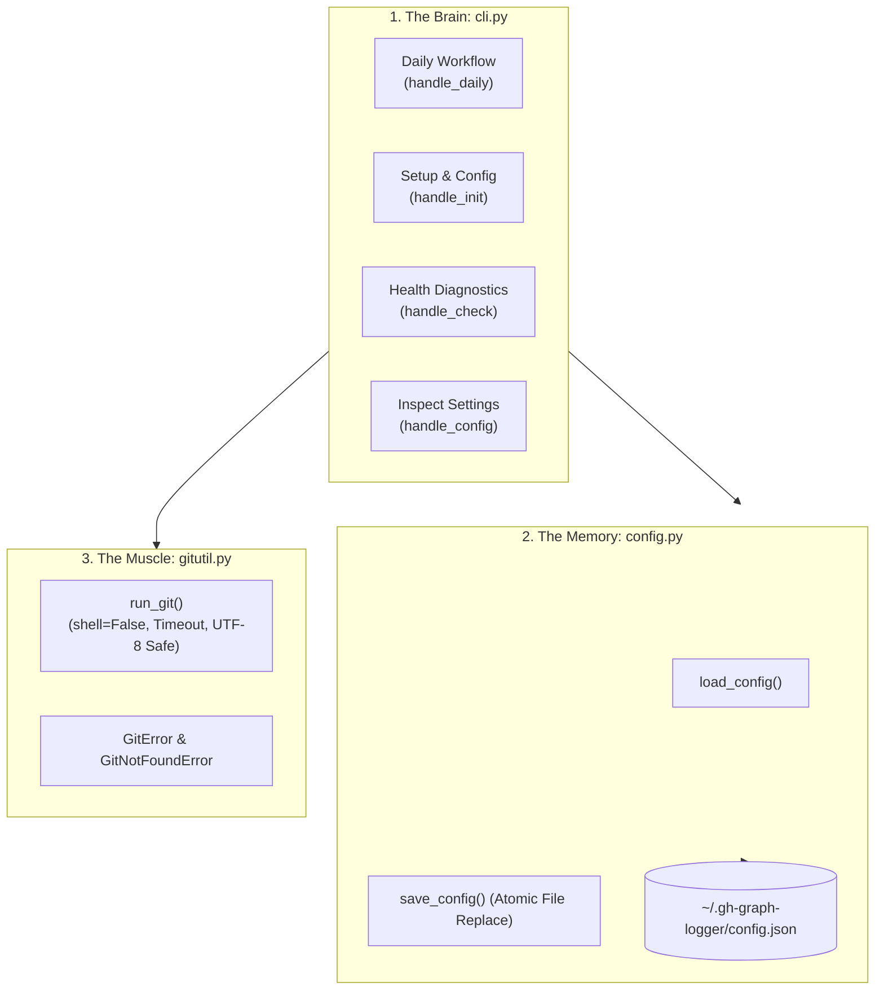
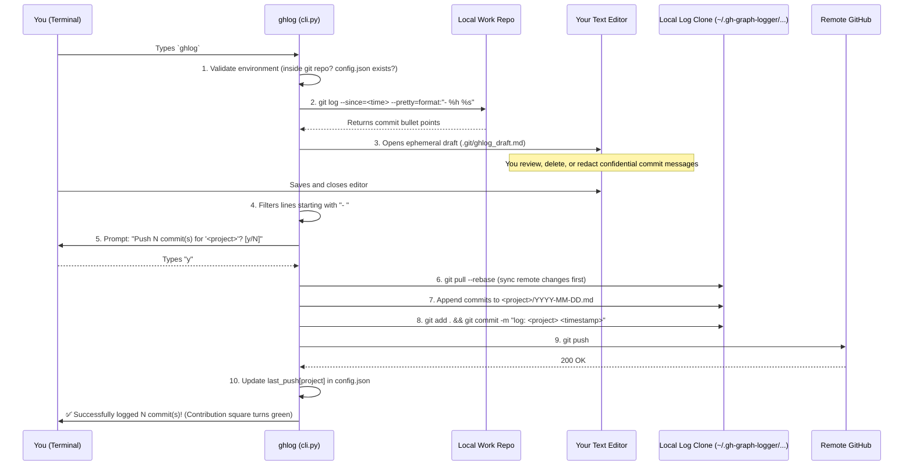

# How `gh-graph-logger` Works: Architecture, Security & Systems Engineering Guide 🧠

Welcome to the deep-dive technical guide for `gh-graph-logger` (CLI alias: `ghlog`)! 

Whether you're exploring the codebase, learning backend and DevOps engineering, or preparing to build your own CLI tools, this guide breaks down every design decision, security hardening mechanism, and architectural pattern used in this project.

---

## 🗺️ High-Level Architecture: The "Trinity"

The entire production tool is intentionally built with **zero external dependencies** using Python's standard library (`subprocess`, `argparse`, `json`, `pathlib`, `shlex`). 

The codebase is split into three focused modules:



| Module | Role | Lines of Code | Responsibility |
|---|---|---|---|
| [`gitutil.py`](../src/gh_graph_logger/gitutil.py) | **The Muscle** | ~114 | Interacts with the operating system to run `git` safely without shell injection. |
| [`config.py`](../src/gh_graph_logger/config.py) | **The Memory** | ~80 | Loads and saves your settings (`~/.gh-graph-logger/config.json`) using atomic file replacement. |
| [`cli.py`](../src/gh_graph_logger/cli.py) | **The Brain** | ~590 | Parses CLI arguments, runs safety guards, resolves editors, and coordinates the daily workflow. |

---

## 🔄 The Lifecycle of a Daily Run (`ghlog`)

What actually happens under the hood when you finish work and type `ghlog` into your terminal?



---

## 🛡️ Production Hardening: 6 Advanced Engineering Details

Writing code that works in the happy path is easy; writing code that survives real-world edge cases is what separates beginners from senior engineers. Here are the 6 hardening features built into this final release:

### 1. Transport Protocol Injection Defense
* **The Vulnerability:** Git allows special URL protocols like `ext::` (which executes arbitrary shell commands!) or `fd::` (file descriptor access). If a tool blindly clones any string a user passes, malicious inputs like `ext::sh -c "calc.exe"` could compromise the system.
* **How `ghlog` prevents it:** In `handle_init()`, URLs are checked and rejected if they use dangerous protocols or start with a dash (`-`):
  ```python
  if url.startswith(("-", "ext::", "fd::")):
      raise GuardError("URLs starting with '-' or using custom transport protocols are not permitted.")
  ```

### 2. The Push Failure Safety Net (Zero Data Loss)
* **The Problem:** What happens if you are on an airplane or your Wi-Fi drops *after* the local commit is made, but *before* `git push` finishes? If the tool blindly recorded `"last_push = today"`, those commits would be skipped tomorrow and lost forever!
* **How `ghlog` solves it:**
  - `git push` is wrapped in a dedicated `try/except GitError`.
  - If pushing fails, a clear warning is printed: *"Commit created locally, but push failed. Preserved locally and will retry on next push."*
  - Crucially, `config.last_push[project]` is **NOT** updated. Next time you run `ghlog`, it will see the unpushed commits and push them cleanly!

### 3. Windows Editor Paths with Spaces
* **The Problem:** On Windows, editors often live in paths with spaces, like `"C:\Program Files\Microsoft VS Code\Code.exe" --wait`. Naively splitting this string with `.split(" ")` breaks the path into `['"C:\\Program', 'Files\\Microsoft...']`.
* **How `ghlog` solves it:**
  - It uses Python's standard library `shlex.split(editor_cmd, posix=(os.name != "nt"))`.
  - It strips extra outer quotes from the executable path so Windows `CreateProcess` launches the editor cleanly without crashing.

### 4. Git Worktrees & Submodules Support
* **The Problem:** In normal Git repos, the git directory is `.git/`. But in **Git worktrees** or **submodules**, `.git` is actually a *file* pointing elsewhere on your drive! Hardcoding `.git/ghlog_draft.md` crashes in worktree setups.
* **How `ghlog` solves it:** It asks Git for the true git directory:
  ```python
  git_dir = Path(run_git(["rev-parse", "--git-dir"], cwd=repo_root))
  draft_file = git_dir / "ghlog_draft.md"
  ```
  This makes `ghlog` 100% compatible with advanced Git workflows like worktrees and monorepo submodules.

### 5. Empty Remote GitHub Repositories
* **The Problem:** When you create a brand-new repository on GitHub without checking "Add a README", the repo has 0 commits and no `HEAD`. When `git ls-remote --exit-code <url> HEAD` runs against an empty repo, Git exits with return code `2`.
* **How `ghlog` solves it:** In `handle_check()`, exit code `2` is specifically caught and treated as a **success** (`Remote access: <url> (empty repository)`), because connecting and seeing an empty repository proves your network, SSH keys, and permissions are working perfectly!

### 6. Atomic Configuration Saves (No Half-Written Files)
* **The Problem:** Using standard `open("config.json", "w")` wipes the file to 0 bytes before writing. If the power cuts out or your machine freezes mid-write, your config file is destroyed.
* **How `ghlog` solves it:**
  - Writes the new configuration to a hidden temporary file in the same directory (`tempfile.NamedTemporaryFile`).
  - Calls `os.replace(temp_file, target_path)`. At the operating system filesystem level, `os.replace` is **atomic**—it swaps the pointer in a single microsecond operation. The file is either the old version or the new version; it can *never* be corrupt!

---

## 🧪 Testing & CI: How 57 Tests Guarantee Reliability

The test suite in `tests/` covers unit tests, failure injection, and end-to-end integration workflows:

```
tests/
├── conftest.py      # Isolated test fixtures (git_repo, bare_remote, seeded_remote, ghlog_home)
├── test_gitutil.py  # Tests subprocess execution, timeouts, UTF-8 decode, missing git
├── test_config.py   # Tests JSON round-trip, GHLOG_HOME override, corrupted file recovery
└── test_cli.py      # Tests full daily workflow, editor mocks, init flows, diagnostics
```

### Hermetic Test Isolation (`conftest.py`)
In DevOps, **hermetic testing** means tests cannot read or modify the host system's configuration.
`tests/conftest.py` achieves this with two automatic fixtures:
1. **`isolate_git_env` (`autouse=True`):** Points `GIT_CONFIG_GLOBAL` to an empty temp file and sets `GIT_CONFIG_NOSYSTEM=1`. Tests run in a cleanroom environment that will never touch your personal `~/.gitconfig`.
2. **`ghlog_home`:** Points `GHLOG_HOME` to a temporary directory so `config.json` tests never touch your real settings.

---

## 💼 Lessons for Your DevOps & Engineering Journey

If you're explaining this project to peers, interviewers, or in a portfolio review, here are the key highlights to focus on:

1. **Radical Simplification:** We intentionally refactored an early 12-file design down to 3 robust modules, eliminating 60% of code while increasing reliability.
2. **True Zero Dependencies:** Built strictly using Python's standard library. No `requests`, no `click`, no `pyyaml`. It installs in seconds and has zero supply-chain vulnerabilities.
3. **Defense-in-Depth:** Subprocesses run with `shell=False`, argument injection is blocked with `--`, transport protocols are sanitized, and files are saved atomically.
4. **Cross-Platform Portability:** CI validates every commit across 15 environments (Windows, macOS, Ubuntu across Python 3.10–3.14).
