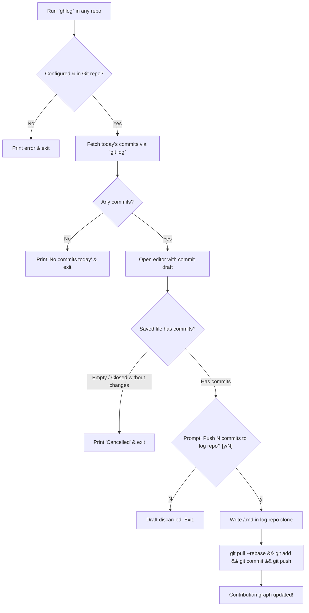

# Implementation Plan — Radical Simplification (Option A)

## Goal
Radically simplify `gh-graph-logger` from an over-engineered 12-module system into a clean, minimal, and maintainable tool (~250 lines total) with zero runtime dependencies, supporting Python 3.10–3.14.

---

## What We Are Letting Go

| Over-Engineered Component | Problem | Simplified Solution |
|---|---|---|
| **6 Disjoint Subcommands** (`init`, `check`, `collect`, `push`, `discard`, `config`) | Requires memorizing commands and managing persistent draft state (`[R]eopen / [O]verwrite / [C]ancel`). | **Single unified daily command (`ghlog`)**: collects commits, opens editor, prompts `Push? [y/N]`, and pushes in one smooth flow. |
| **Custom TOML Fallback Parser** | 70+ lines of fallback parser written because Python 3.10 lacks `tomllib`. | **`config.json`**: Uses Python's native `json` module. Zero dependencies, identical across Python 3.10–3.14. |
| **Delimited ASCII Log Parsing** | Unit (`\x1f`) & record (`\x1e`) separators, custom parsing, sorting, and manual bullet reconstruction. | **Native Git formatting**: `git log --reverse --since="midnight" --pretty=format:"- %h %s"` outputs clean Markdown bullets directly. |
| **Windows Git Internal Path Probing** | Probing Git's private directories (`/usr/bin/vim.exe` vs `vi`) and environment hacking. | **Standard Editor resolution**: Use `$GIT_EDITOR` / `$EDITOR` with clean fallback to `notepad` (Windows) or `vim` (Unix). |
| **Draft State Machine** | Managing persistent draft files, reopen/overwrite/cancel menus, `#` vs `##` stripping rules. | **Session draft**: A temporary draft file during the `ghlog` run. If emptied or declined, it is immediately discarded. |
| **Local Config & First-Time Prompts** | Storing `ghlog.project` in local `.git/config` via interactive prompts. | **Default to folder name**: Project name is `Path.cwd().name`. Override anytime with `--project <name>`. |
| **File Sprawl (12 Files)** | Micro-packages (`commands/`), console abstractions, custom exit codes. | **Consolidate to 3 files**: `cli.py`, `gitutil.py`, and `config.py`. |

---

## Simplified Workflow



---

## Command Surface

1. **`ghlog init`**
   - Options: `--url <URL>`, `--email <EMAIL>`, `--root <DIR>` (default: `~/.gh-graph-logger`).
   - Clones target repo and saves `~/.gh-graph-logger/config.json`.
2. **`ghlog`** (Daily core command)
   - Options: `--since <TIME>`, `--author <EMAIL>`, `--project <NAME>`, `--yes`.
   - Runs the complete flow: grab commits $\rightarrow$ open editor $\rightarrow$ confirm $\rightarrow$ commit & push to log repo.
3. **`ghlog check`**
   - Quick verification that git is installed, you're in a repo, and log repo clone is accessible.
4. **`ghlog config`**
   - Displays the current configuration.

---

## Proposed Code Structure

Instead of 12 files across nested packages, the source tree becomes:

```
src/gh_graph_logger/
├── __init__.py      # Version string
├── gitutil.py       # Safe subprocess.run wrapper (~40 lines)
├── config.py        # JSON config loader/saver (~40 lines)
└── cli.py           # Parser, init, check, and the unified daily flow (~150 lines)
```

### Module Responsibilities

#### `gitutil.py`
- `run_git(args, cwd=None, env=None, check=True)`: Clean `subprocess.run(["git", *args])`, UTF-8 decode with replacement, returns stdout.
- `GitError`: Exception with returncode and stderr.

#### `config.py`
- `Config` dataclass: `log_repo_url`, `clone_path`, `branch`, `github_email`, `last_push`.
- `load_config()`, `save_config(config)`: Simple, robust `json.dump` / `json.load` to `~/.gh-graph-logger/config.json`.

#### `cli.py`
- `init`: Clones the log repo, sets its `user.email` and `user.name`, saves `config.json`.
- `check`: Tests git and verifies `config.json` and clone directory.
- `run` (default `ghlog`): 
  1. Checks current directory is a git repo.
  2. Queries `git log --reverse --since="midnight" --pretty=format:"- %h %s"`.
  3. Writes draft to `.git/ghlog_draft.md`.
  4. Launches editor.
  5. If content is empty or unchanged, deletes draft and exits.
  6. Prompts `Push to log repo? [y/N]` (or auto-approves with `--yes`).
  7. Copies file into `<log-repo>/<project>/<timestamp>.md`.
  8. Runs `git pull --rebase`, `git add .`, `git commit -m "log: <project> <timestamp>"`, and `git push`.
  9. Removes `.git/ghlog_draft.md`.

---

## Verification Plan

### Automated Tests
- Test configuration saving and loading (`config.json`).
- Test `git log` generation with multiple commits.
- Test `init` cloning into custom root directories.
- Test full run: commits generated $\rightarrow$ editor saves $\rightarrow$ pushed to bare remote.
- Test cancellation: user saves empty file $\rightarrow$ no push occurs.
- Run `ruff check .` and `pytest -v`.
