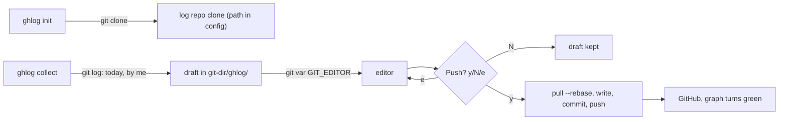
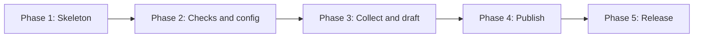

# gh-graph-logger v2 — Python CLI Implementation Plan (v3)

## Goal
A Python CLI that you run by hand. There are no git hooks. It works like this:
1. It checks that you are **inside a git repo** and **can push to the log repo**. If either check fails, it stops.
2. `collect` gathers **your commits from today, up to now**, into a draft. The draft opens in **git's own editor**, the same one git opens for a merge commit, so you can remove anything confidential.
3. After you save, it **asks for confirmation**. Only after you answer yes does it write `<project>/<YYYY-MM-DD_HH-MM-SS>.md` into a **local clone of the log repo** and run `git commit` and `git push`.
4. Anyone can install it from PyPI with `pipx install gh-graph-logger`. It supports Python **3.10 – 3.14** and has **zero dependencies**.



## Decisions so far

| Topic | Decision |
|---|---|
| How logs reach GitHub | A local clone of the log repo and plain `git`. No API calls and no token are stored |
| Credentials | Whatever git login you already use (SSH, Git Credential Manager, `gh`) |
| Dependencies | None. Only the Python standard library and the `git` binary |
| Editor | Taken from `git var GIT_EDITOR`, which behaves like a merge-commit message |
| Push | Always asks for confirmation first (`y/N/e`, default **No**). `--yes` skips the prompt for scripts |
| Name | `gh-graph-logger`, with the alias `ghlog` |
| Format | Markdown |
| Commit date | Push time (one green square per push) |
| Sync before writing | `git pull --rebase`, which keeps history linear. Unique file names mean it never conflicts |

---

## New points added

### 1. Log-repo clone location and relocation
- **Choosing the root directory:** `ghlog init` lets you choose the **root directory** where the log repo is cloned. The clone goes into `<root>/<repo-name>`.
  - Interactive prompt: *"Root directory for the log repo [~/.gh-graph-logger]:"*. Press Enter to accept the default.
  - Without the prompt: `ghlog init --root D:\logs`, which clones into `D:\logs\daily-commits`.
  - `~` and environment variables are expanded, and the path is resolved to an absolute path.
  - If the root doesn't exist, the tool asks whether to create it.
  - If `<root>/<repo-name>` already exists:
    - if it is a clone of the same repo, the tool reuses it;
    - otherwise it stops and changes nothing.
  - The tool checks that the root isn't inside one of your work repos, so the log repo is never nested inside a project.
- **Saving the location:** the resulting clone path is saved in `~/.gh-graph-logger/config.toml`. This config file always stays in the same place, so the tool can find the clone wherever you put it.
- Before every push, the tool **checks the clone**: the folder exists, it is a git repo, and its `origin` URL matches the config.

| Situation | Behaviour |
|---|---|
| Valid clone | Normal push |
| Folder missing | Stops with: *"Log repo not found at X. Run `ghlog init --path <new>` or run `ghlog init`."* |
| `origin` URL doesn't match | Refuses to write anything, so logs never go to the wrong repo |

### 2. Separate identity for the log repo
- `ghlog init` asks for your **GitHub email**, meaning a verified email or your `noreply` address.
- It sets `user.name` and `user.email` **only in the log repo clone**. Your work repos are not touched.
- Reading commits uses the **author emails of each work repo** (see point 4). Writing log commits uses the **GitHub email**.

### 3. Project name confirmation
- The default is the repo's top-level folder name, turned into a slug. For example, `Payment Service` becomes `payment-service`.
- The **first time** you run `collect` in a repo, it asks: *"Project name in the log repo [payment-service]:"*. Your answer is saved in that repo's local config as `ghlog.project`, so the question is never asked again.
- Typical reasons to change it: to hide a client name with an alias, to keep apart two repos that share a folder name, or to keep a stable name when a folder is renamed.
- `--project` overrides it for a single run.

### 4. Edge cases across repos

| Case | Handling |
|---|---|
| You committed with different emails in different repos | `git config ghlog.author` per repo (several emails, comma-separated). The default is that repo's `user.email`. `--author` works for a single run |
| Rebased or amended old commits look like today's | Shown in the editor so you can delete them. The time window starts at **max(midnight, last push for this project)** |
| Your own commits pulled from another machine | Only **local branches** are scanned (`--branches`, not `origin/*`). You review the list before pushing |
| Worktrees and submodules | The draft path comes from `git rev-parse --git-dir`, never a hard-coded `.git/` |
| Repo with no commits, or none today | Prints a friendly message and creates no file |
| Git missing from PATH | `ghlog check` reports it clearly |
| Commit messages that aren't UTF-8 | Decoded with replacement characters, so the tool never crashes |
| Teammates' commits | Filtered out by author |

---

## Commands (final)

| Command | Purpose |
|---|---|
| `ghlog init [--root DIR] [--path P] [--url URL] [--email EMAIL] [--branch BRANCH] [--name NAME] [--yes]` | Configures the log repository. Prompts for URL, root directory (default `~/.gh-graph-logger`), and GitHub email if not passed via `--url`, `--root`, `--email`. `--root` clones under DIR; `--path` adopts an existing moved clone; `--yes` accepts defaults and auto-creates root. |
| `ghlog check` | Shows ✅ or ❌ for git, inside a repo, the log repo clone, and remote access (`git ls-remote`) |
| `ghlog collect [--since] [--author] [--full] [--project]` | Runs the checks, opens the draft in the editor, then asks for confirmation and pushes |
| `ghlog push [--yes]` | Pushes an existing draft, with a confirmation prompt. Also retries log commits that weren't pushed |
| `ghlog discard` | Deletes the draft |
| `ghlog config --show` | Prints the config |

Exit codes: `0` ok, `1` error, `2` usage error (argparse), `3` a check failed, `4` aborted by you.

---

## Implementation Phases

Each phase ends in a **working, tested state**. I'll stop after each phase so you can review it.



### Phase 1: Project skeleton
**Goal:** an installable package that does nothing yet.
#### [NEW] pyproject.toml
Uses hatchling, `requires-python >=3.10`, no dependencies, entry points `gh-graph-logger` and `ghlog`, and the dev extras `pytest` and `ruff`.
#### [NEW] src/gh_graph_logger/__init__.py, cli.py
`argparse` with all subcommands as stubs, plus `--version` and the exit codes.
#### [NEW] src/gh_graph_logger/gitutil.py
`run_git(args, cwd)`: runs git through `subprocess` with an argument list (never a shell), safe decoding and timeouts.
#### [NEW] tests/conftest.py
Fixtures that create temporary git repos and a bare "fake GitHub" remote.
#### [NEW] .github/workflows/ci.yml
Runs ruff and pytest on {Windows, macOS, Linux} × Python 3.10–3.14.

**Done when:** `pip install -e .[dev]` works, `ghlog --help` lists the commands, and CI is green.

---

### Phase 2: Checks and global config
**Goal:** `ghlog init`, `ghlog check` and `ghlog config --show` work.
#### [NEW] config.py
Reads and writes `~/.gh-graph-logger/config.toml` (or `$GHLOG_HOME/config.toml`): repo URL, clone path, branch, GitHub email, and last push time per project. Uses standard library `tomllib` on Python 3.11+ and a lightweight zero-dependency parser fallback on Python 3.10; writes atomically via a built-in serializer.
#### [NEW] guards.py
`require_git()`, `require_git_repo()`, `require_log_repo()` (the clone checks from point 1) and `require_remote_access()` (`git ls-remote` with a timeout).
#### [MODIFY] cli.py
Implements `init` (prompts, choosing the root directory with `--root`, cloning, setting the local identity, `--path`, plus non-interactive testability flags `--url`, `--email`, `--branch`, `--name`, `--yes`), `check` and `config --show`.
Strictly non-destructive: no directory deletions.

**Done when:** tests pass for a missing repo, a moved clone, a mismatched URL, an unreachable remote, a custom `--root`, a root that doesn't exist yet, and a root that is inside a work repo.

---

### Phase 3: Collect and draft
**Goal:** `ghlog collect` opens the editor with the right commits. Nothing is pushed yet.
#### [NEW] project.py
Slug rules, the prompt shown on first use, and storage in `ghlog.project`.
#### [NEW] collector.py
Runs `git log --branches --since=<max(midnight,last_push)> --author=<emails>` with a field-separated format, removes duplicates by hash, and sorts by time.
#### [NEW] draft.py
Renders the Markdown and `#` instructions, writes the draft to `<git-dir>/ghlog/draft.md`, opens `git var GIT_EDITOR`, and removes comment lines. An empty result aborts.

**Done when:** tests cover filtering by author, worktrees, no commits today, a non-UTF-8 message and an empty draft. You can try it by hand on your real repos, because nothing is pushed.

---

### Phase 4: Publish
**Goal:** the full flow from collect to confirm to push.
#### [NEW] scanner.py
Regex patterns for tokens, private keys, `password=` and similar. Any matches are shown in the confirmation prompt.
#### [NEW] publisher.py
Checks the clone, runs `pull --rebase`, writes `<project>/<ts>.md`, then `add`, `commit` and `push`. If the push fails, the commit is kept locally and retried on the next push. The last push time is updated only after a successful push.
#### [MODIFY] cli.py
The `y/N/e` prompt, `push`, `--yes` and `discard`.

**Done when:** end-to-end tests against the bare remote cover two "machines" pushing in turn, an offline push followed by a retry, and the user answering N.

---

### Phase 5: Docs and release
#### [MODIFY] README.md
Rewritten: install, `init`, the daily workflow, the email and green-square rules, privacy tips and troubleshooting.
#### [MODIFY] .github/workflows/ci.yml
Publishes to PyPI with Trusted Publishing when a `v*` tag is pushed.
#### [NEW] CHANGELOG.md

**Done when:** `pipx install gh-graph-logger` works from TestPyPI on Windows, macOS and Linux.

---

## Verification Plan
### Automated (in every phase)
```
pip install -e .[dev]   # install the tool and dev tools in editable mode
ruff check .            # static checks for bugs and style
pytest -q               # tests in temp git repos with a fake local GitHub
```
### Manual (after Phase 4)
1. Run `ghlog check` outside a repo → ❌. Move the clone → a clear relocation message.
2. Run `ghlog collect` in a work repo → it asks for the project name once, then your editor opens.
3. Delete a line, save, answer **N** → nothing is pushed. Run `ghlog push` and answer **y** → the file appears on GitHub and the square turns green.
4. Run `collect` again → only new commits are listed.
